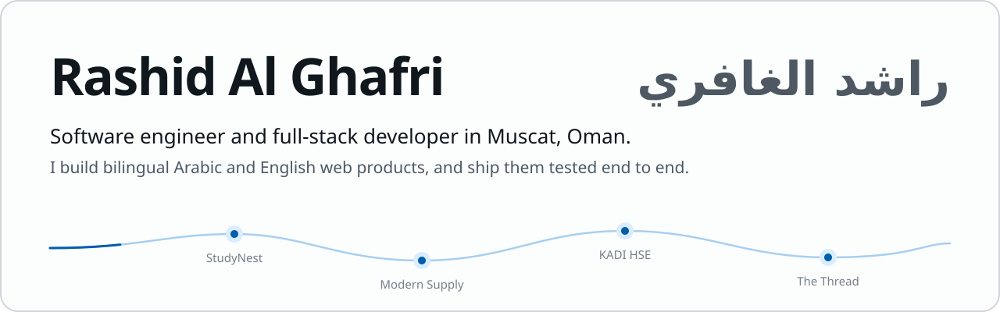
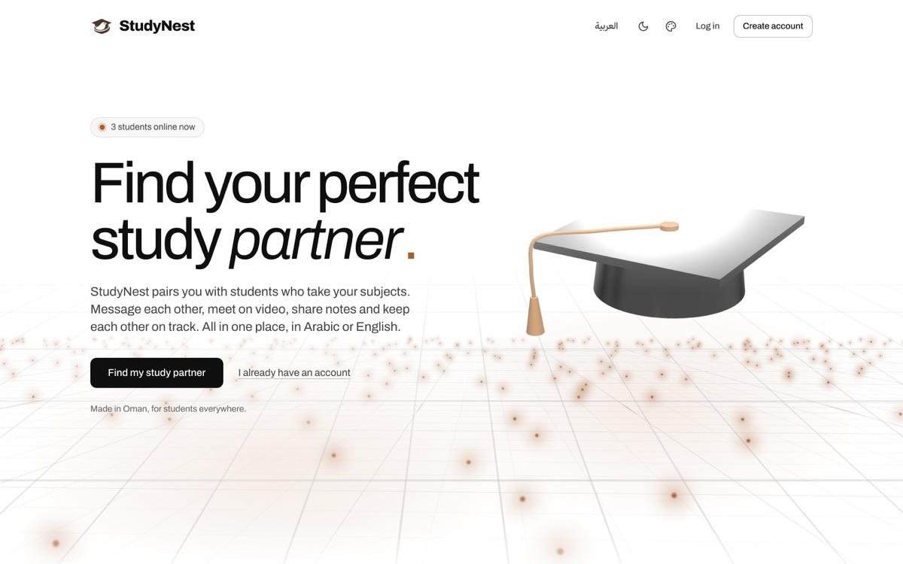
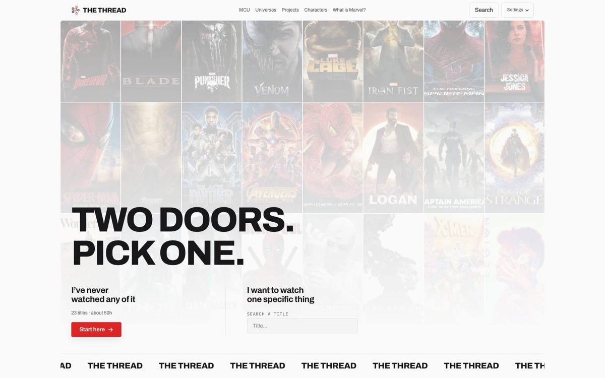
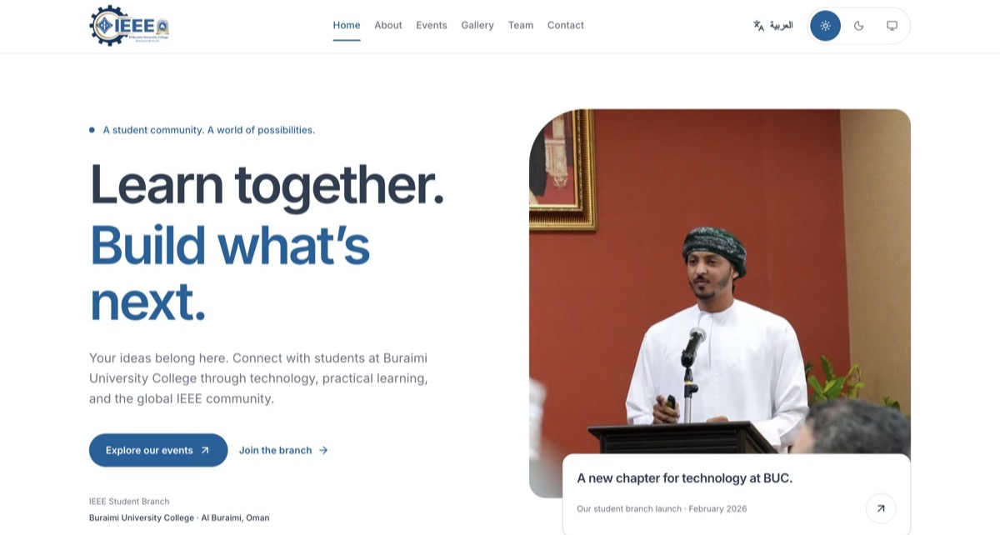
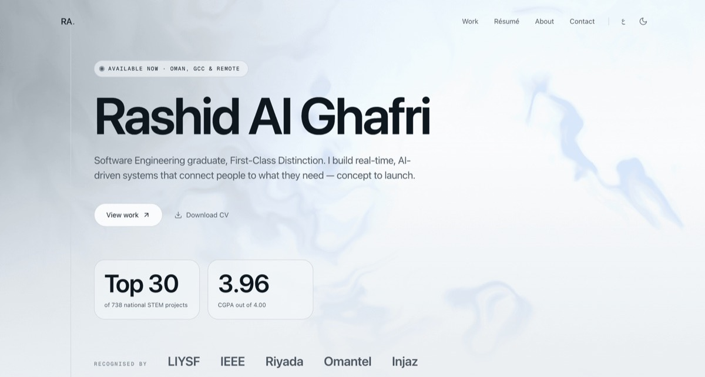
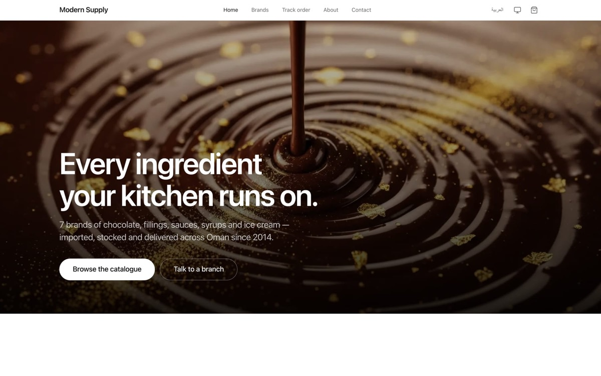
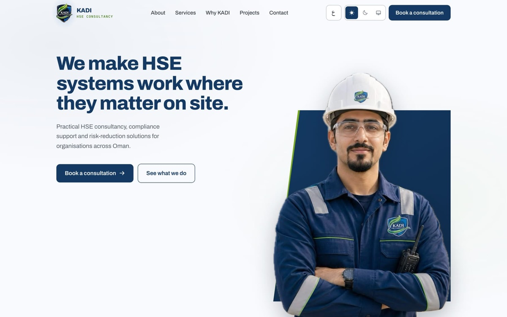
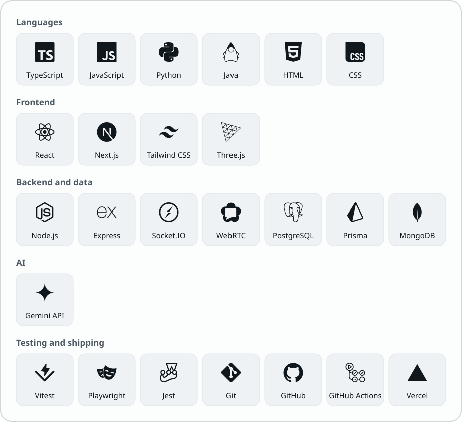

<picture>
  <source media="(prefers-color-scheme: dark)" srcset="assets/header-dark.svg">
  
</picture>

  <a href="https://rashidalghafri.com"><b>Portfolio</b></a> &nbsp;·&nbsp;
  <a href="https://linkedin.com/in/rashid-al-ghafri"><b>LinkedIn</b></a> &nbsp;·&nbsp;
  <a href="mailto:rashidalghafri.dev@gmail.com"><b>Email</b></a>

Software Engineering graduate, BSc with **CGPA 3.96/4.00** and First-Class Distinction (July 2026). I build web products for real clients in Arabic and English, with full right-to-left layout, and I test them end to end before they ship. Strongest on the frontend, comfortable across the stack. Currently an HSE trainee at Nama Water Services.

## Projects

<table>
<tr>
<td width="50%" valign="top">
<a href="https://studynest.dev"><picture><source media="(prefers-color-scheme: dark)" srcset="assets/studynest-dark.jpg"></picture></a>

**[StudyNest](https://studynest.dev)** 
Find a study partner, then actually study together: chat, video study rooms with screen share and a shared focus timer, sessions, shared notes, and Nour (نور), an AI study buddy. Partner matching is a weighted score over seven profile factors, not AI.

Senior capstone, graded Distinction · 22 data models · 387 passing tests · 44-student pilot: 86% high satisfaction 
<code>Next.js 16</code> <code>React 19</code> <code>Node.js</code> <code>MongoDB</code> <code>Socket.IO</code> <code>WebRTC</code> <code>Gemini API</code>

[Live](https://studynest.dev) · [Case study](https://rashidalghafri.com/projects/studynest) · [Source](https://github.com/rworldx/StudyNest-Source)
</td>
<td width="50%" valign="top">
<a href="https://the-thread-marvel.vercel.app"><picture><source media="(prefers-color-scheme: dark)" srcset="assets/the-thread-dark.jpg"></picture></a>

**[The Thread](https://the-thread-marvel.vercel.app)** 
Name one Marvel title and get the shortest watch path to it across 216 films and series. Built as a dependency resolver over 699 characters. Independent fan project, not affiliated with Marvel or Disney.

1,893 static pages in English and Arabic · 321 unit tests · 55 browser tests 
<code>Next.js 16</code> <code>TypeScript</code> <code>Vitest</code> <code>Playwright</code>

[Live](https://the-thread-marvel.vercel.app) · [Case study](https://rashidalghafri.com/projects/the-thread)
</td>
</tr>
</table>

<table>
<tr>
<td width="50%" valign="top">
<a href="https://ieee-buc-website.vercel.app"><picture><source media="(prefers-color-scheme: dark)" srcset="assets/ieee-dark.jpg"></picture></a>

**[IEEE BUC Student Branch](https://ieee-buc-website.vercel.app)** 
The official website of the IEEE Student Branch at Al Buraimi University College. Built alone in the branch's founding year; I still maintain it as Webmaster.

Certificate from the IT Department for the branch's official launch 
<code>Next.js</code> <code>TypeScript</code> <code>Tailwind CSS</code>

[Live](https://ieee-buc-website.vercel.app) · [Source](https://github.com/rworldx/ieee-buc-website)
</td>
<td width="50%" valign="top">
<a href="https://rashidalghafri.com"><picture><source media="(prefers-color-scheme: dark)" srcset="assets/portfolio-dark.jpg"></picture></a>

**[Personal portfolio](https://rashidalghafri.com)** 
Every project told as a story, in English and Arabic with full right-to-left layout, around an interactive graph of how the work connects.

Arabic and English · light and dark 
<code>Next.js 15</code> <code>TypeScript</code> <code>Three.js</code> <code>Tailwind CSS</code>

[Live](https://rashidalghafri.com) · [Source](https://github.com/rworldx/rashidalghafri-portfolio)
</td>
</tr>
</table>

## Client work

<table>
<tr>
<td width="50%" valign="top">
<a href="https://modernsupply.om"><picture><source media="(prefers-color-scheme: dark)" srcset="assets/modern-supply-dark.jpg"></picture></a>

**[Modern Supply](https://modernsupply.om)** 
E-commerce for an Omani food-service distributor. 654 products across 5 brand catalogues, one cart, cash-on-delivery orders with tracking numbers, and an admin dashboard for orders, stock, discounts and delivery fees.

119 unit tests · Arabic and English 
<code>Next.js 16</code> <code>TypeScript</code> <code>PostgreSQL</code> <code>Prisma</code>

[Live](https://modernsupply.om) · [Case study](https://rashidalghafri.com/projects/modern-supply)
</td>
<td width="50%" valign="top">
<a href="https://kadi-hse.om"><picture><source media="(prefers-color-scheme: dark)" srcset="assets/kadi-dark.jpg"></picture></a>

**[KADI HSE Consultancy](https://kadi-hse.om)** 
Website for a health, safety and environment consultancy in Oman. The Arabic is written natively, with full right-to-left layout, not translated after the fact.

Lighthouse 100 in all four categories (desktop, English) · 141 unit tests 
<code>Next.js</code> <code>TypeScript</code> <code>Tailwind CSS</code>

[Live](https://kadi-hse.om) · [Case study](https://rashidalghafri.com/projects/kadi-hse)
</td>
</tr>
</table>

Source code for client work is private.

## Tools I use

<picture>
  <source media="(prefers-color-scheme: dark)" srcset="assets/stack-dark.svg">
  
</picture>

## Highlights

- **National Finalist, top 30 of 738**: London International Youth Science Forum, 2026, presenting StudyNest
- **2nd place**: Riyada Promising Student Projects Camp, 2025 (EnerGrid, a team smart-energy concept; I built the web prototype)
- **CGPA 3.96/4.00**, First-Class Distinction, College Honour List every semester, Distinguished Student 2026
- **IEEE Student Branch Webmaster**, with a certificate for the branch's official launch

---

Let's build something: <a href="https://rashidalghafri.com">rashidalghafri.com</a>

